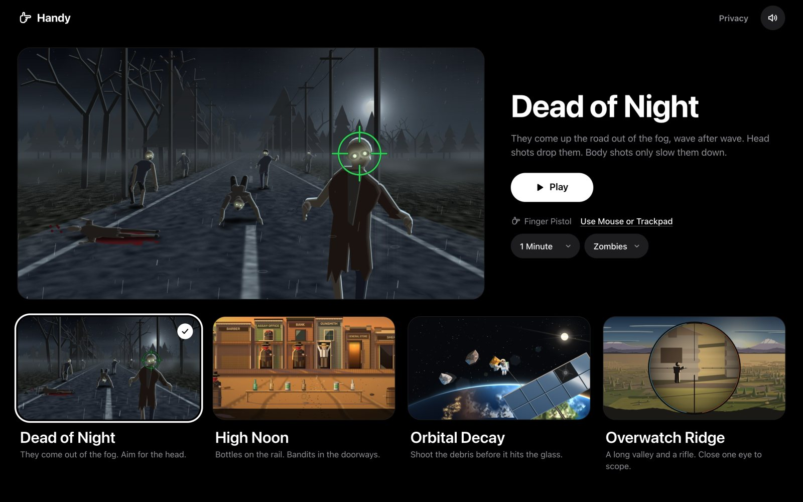
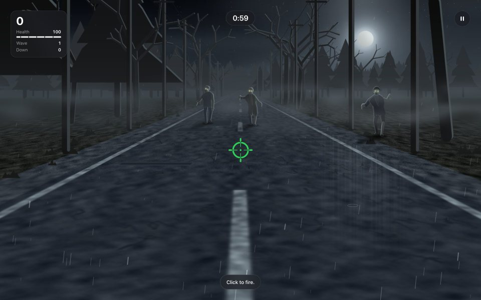
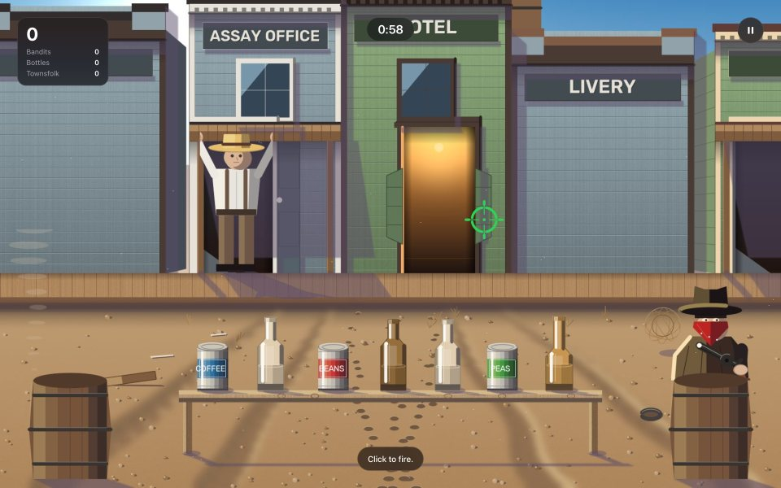
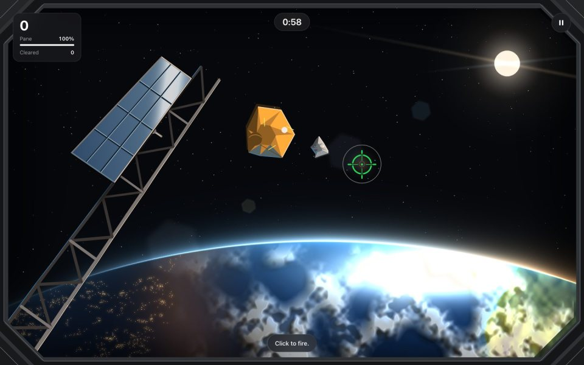
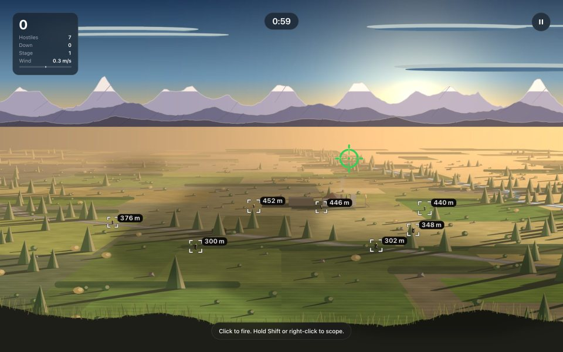
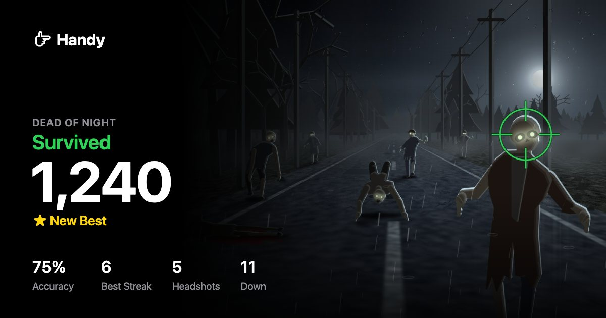

# Handy

**An arcade you play with your hand.** Point your finger at the screen, fold
your thumb to fire. Four games, one webcam, and nothing to hold.



Everything runs on your computer. The camera picture never leaves it.

## Play in thirty seconds

You need [uv](https://docs.astral.sh/uv/getting-started/installation/). Then:

```bash
uvx --python 3.12 --from git+https://github.com/arthurenard/claude-of-duty handy --browser
```

Handy opens in your browser. Pick a game, press **Play**, and allow the camera.
The first time, it downloads its tracking models (about 12 MB); after that
it never needs the network.

No camera? Choose **Use Mouse or Trackpad** and play straight away.

## How to play

1. **Point.** Hold your hand like a pistol. The crosshair follows your index
   fingertip.
2. **Fire.** Fold your thumb down, like a hammer falling. Raise it to fire again.
3. **Warm up once.** The first time, Handy asks for a few shots at the Target
   Range to learn your aim, then five centre hits to check it. Next time it
   remembers, and you go straight into the game. **Adjust Aim** is always one
   click away if you move your camera or your chair.

In Overwatch Ridge, close one eye to look down the rifle's scope. There is
nothing to set up for that; Handy notices.

## The games

| | |
| --- | --- |
|  **Dead of Night** — They come up the road out of the fog, wave after wave. Head shots drop them; body shots only slow them down. Choose zombies or humanoid robots. |  **High Noon** — Bottles on the rail, bandits in the doorways, and townsfolk you must not hit. The quicker the draw, the bigger the score. |
|  **Orbital Decay** — Debris tumbling toward the station window. Big pieces split when you hit them, and keep coming. |  **Overwatch Ridge** — A long valley and a rifle. The round drops and the wind drifts it; the reticle's marks tell you how far to hold over. |

Every round ends on a card worth passing round: your score, your best, and
**Share** for a picture of it.



## Install it

To keep the `handy` command around:

```bash
uv tool install --python 3.12 git+https://github.com/arthurenard/claude-of-duty
handy --browser   # the arcade in your browser
handy             # the same games in a fullscreen window
```

`uv tool upgrade handy` updates it; `uv tool uninstall handy` removes it. Keep
`--python 3.12`: without it, uv may pick a Python that Handy does not support.

**Camera permission.** In the browser, allow the camera for `127.0.0.1` (macOS
may also ask whether the browser itself may use it). The fullscreen app uses
your terminal's permission: macOS asks the first time, and the setting lives in
**System Settings → Privacy & Security → Camera**. Restart the terminal after
changing it.

**Where it runs.** Handy runs wherever MediaPipe 0.10.35 and OpenCV publish
wheels:

- **macOS 13 or later on Apple silicon**, where it is made and played.
- **Linux on x86_64** (glibc 2.28 or later). CI runs the tests there, but nobody
  has played it there with a camera yet. It needs the OpenGL, EGL and GLib
  libraries a desktop already has (Debian or Ubuntu: `libgl1 libegl1 libgles2
  libglib2.0-0`).
- **Windows on x86_64**: the wheels exist, but Handy hasn't been tried there.
- **Not supported:** Intel Macs, ARM Linux (such as a Raspberry Pi) and Windows
  on ARM, which MediaPipe 0.10.35 or OpenCV publishes no wheel for.

## Privacy

Hand tracking is Google's MediaPipe, running on your computer's CPU. In the
browser, camera frames go only from the page to the Handy process on the same
machine, over `127.0.0.1`; they are read in memory and never saved or sent
anywhere. The only network access is the one-time model download, which is
pinned to a version and checked against its SHA-256 before it is used.

## The fullscreen app

`handy` opens the same games fullscreen, with multi-camera support and the full
set of options below.

| Key | In a round | On the score card |
| --- | --- | --- |
| `P` or `Esc` | Pause (Resume, Restart, Choose a Game, Quit) | |
| `R` | Restart | Play again (also `Space`) |
| `B` | Choose a game | Choose a game |
| `C` | Adjust aim | Adjust aim |
| `S` | Save a screenshot | Save the card |
| `N` | Switch opponent (Dead of Night) | |
| `Q` | Quit | Quit (also `Esc`) |

In the chooser, `1`–`4` pick a game. During aim setup, `B` undoes a shot, `R`
starts over and `Esc` skips. Everything is also a button you can shoot.

In the browser: `P`, `Space` or `Esc` pause, `M` mutes, and during aim setup
`B` undoes a shot and `R` starts over.

<details>
<summary><strong>Options</strong></summary>

`--browser` takes only `--port` and `--no-open`; choose everything else in the
page. The other options are for the fullscreen app.

| Flag | Default | Purpose |
| --- | --- | --- |
| `--browser` | off | Open the arcade in your browser |
| `--port` | `8765` | The browser arcade's port (with `--browser`) |
| `--no-open` | off | Don't open a tab (with `--browser`) |
| `--map` | chooser | Start straight into `zombies`, `western`, `orbit` or `sniper` |
| `--enemy` | `zombies` | Dead of Night: `zombies` or `robots` |
| `--duration` | `60` | Seconds per round, up to 3600; `0` never ends |
| `--camera` | first live camera | Camera index; repeat it to aim with several |
| `--list-cameras` | | List cameras and exit |
| `--capture` | `1280x720` | Camera resolution |
| `--no-mirror` | off | Use the camera picture unmirrored |
| `--calibrate` | off | Set up your aim again (not with `--no-calibration`) |
| `--no-calibration` | off | Skip setup and aim with the defaults |
| `--calibration-file` | `~/.cache/handy/calibration.json` | Where your aim is saved |
| `--min-cutoff` | `1.2` | Steadiness when you hold still |
| `--beta` | `0.8` | Responsiveness when you move |
| `--fire-above` | `0.5` | How far the thumb folds to fire |
| `--arm-below` | `0.3` | How far it comes back to fire again |
| `--recoil` | `26` | Crosshair kick in pixels; `0` turns it off |
| `--mute` / `--volume` | sound on / `1.0` | Sound; volume 0–1 |
| `--targets` | `3` | Targets a round opens with (1–20; not High Noon) |
| `--spawn-interval` | `1.1` | Seconds between spawns as a round opens (not High Noon) |
| `--lifetime` | `5.0` | Target Range face lifetime; no game reads it |
| `--seed` | random | The same round every time, for practice |
| `--model` | cached download | Your own hand `.task` model |
| `--screenshot-dir` | `screenshots/` | Where screenshots and cards are saved |
| `--debug` | off | Show the tracking measurements |
| `--control` | `pistol` | The only hand control; kept for old scripts |

</details>

## Development

```bash
git clone https://github.com/arthurenard/claude-of-duty
cd claude-of-duty
uv sync                          # .venv, with Handy installed in editable mode
uv run handy --browser
uv run pytest
uv run ruff check handy tests
for f in handy/web/*.js; do node --check "$f"; done
uv build                         # sdist and wheel, into dist/
```

CI runs the lint, the tests and the script check on macOS (Apple silicon) and
Ubuntu, then builds the wheel, installs it into a clean environment and starts
the browser arcade from it.

- `handy/browser.py`, `handy/web/`: the browser arcade, a local server and a
  dependency-free page.
- `handy/app.py`, `handy/scene.py`, `handy/cli.py`: the fullscreen app.
- `handy/game.py`, `handy/maps/`: the games' rules and drawing, shared by both.
- `handy/shot_calibration.py`, `aiming.py`, `recognition.py`: hand tracking,
  the trigger and aim setup.
- `tests/`: rules, aim, tracking, drawing, the browser server and the app.

Every picture in Handy is drawn with OpenCV and numpy; there isn't one image
file in the game. The design language both surfaces follow is in
[docs/DESIGN.md](docs/DESIGN.md), and the engine's inner workings are in
[docs/ENGINE_NOTES.md](docs/ENGINE_NOTES.md).
