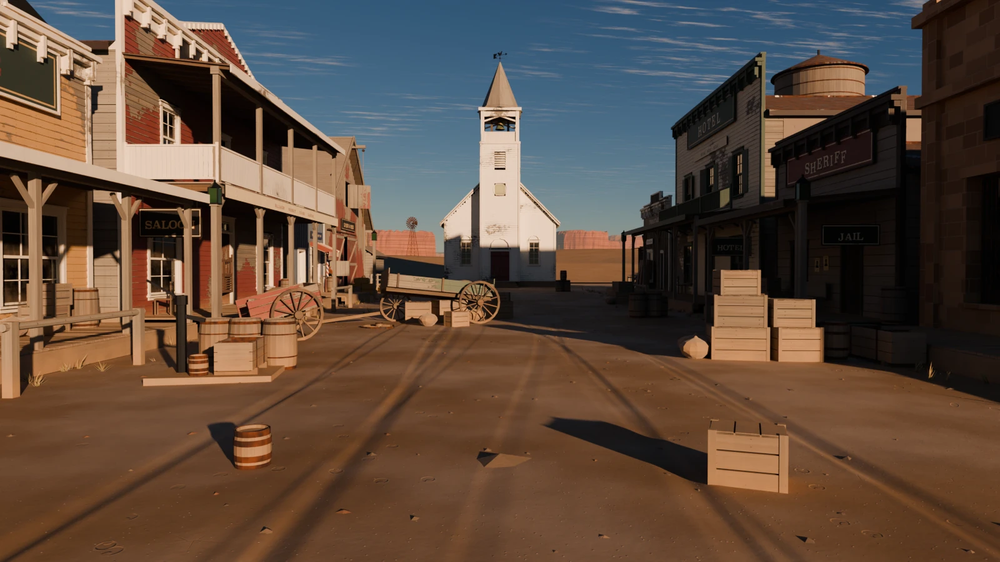

# Super Claude Bros.

**An arcade you play with your hand.** Point your finger at the screen, fold
your thumb to fire. It runs in your browser, sees your hand through your
webcam, and never sends the picture anywhere.

**Play it at https://www.arthurenard.me/super-claude-bros/**



## The games

- **High Noon.** Golden hour in Dust Creek, and the Carver gang comes out of
  every window, doorway and barrel: runners, dynamite you can shoot out of the
  air, riflemen on the roofs, and Black Jack Carver himself. Six shots; spare
  the townsfolk.
- **Dead of Night.** Midnight at a gas station on Route 9, and the dead walk
  out of the fog into your flashlight. Eight rounds and a barricade.
- **Orbital Decay.** Four hundred kilometres up, in a space station's glass
  cupola, with a cloud of wreckage coming at the windows. The laser never runs
  out, but it heats; seven panes stand between you and the vacuum.
- **Overwatch Ridge.** First light over an alpine valley, a bolt-action rifle
  with five rounds and a six-times scope. Range, drop and wind are yours to
  read.

Get hit and the picture bleeds red at the edges; a few seconds unhurt and you
recover (in Orbital Decay the glass takes the damage, and a pane that fails
ends the game). Each game hides **eight secrets**. In High Noon, try the bell.

And a different kind of game, on its own page: **Grip Prix**, a kart racer for
up to four that you steer with both hands held up like a wheel (see [Play Grip
Prix](#play-grip-prix)).

## Play

Open the site in a current browser on a computer with a webcam, choose
**Play** on the Finger Guns tile (or **Race** for Grip Prix), choose a game in
the arcade's row, choose **Play**, and allow the camera. A link to a game
(`…/#high-noon`) opens the arcade on it, and `…/#finger-guns` on the game you
chose last. To run it on your own machine, see [Development](#development).

**How to aim.** Hold your hand like a pistol; the crosshair follows your index
fingertip. Fold your thumb down to fire, raise it to cock again. If your
hand leaves the camera's view mid-round, the round waits for it and counts you
back in; after a fall, fold your thumb on the results to play again.

**Reload and vent.** Point past the edge of the screen (a hand swung out of
the picture counts): that reloads in High Noon, Dead of Night and Overwatch
Ridge, and vents the overheated laser in Orbital Decay. In Overwatch Ridge,
raise your thumb after each shot to work the bolt.

**The scope.** Overwatch Ridge alone has one: **close one eye**, or hold
**Shift** or the **right mouse button**, or use the **Scope** button in the
bottom-left corner of a touch screen, and the view jumps to six times. Shift,
the right button and the Scope button work with your hand as with the mouse.
Your hand then pans it a quarter as fast, so a tremor is a quarter as big.
Pointing off the screen reloads only while you are not scoped.

The eye adapts to you: it follows how far your eyes read open, learns how far
yours shut, and keeps the scope while your pointing hand hides your face (until
you open the eye, or ten seconds). A small eye beside the magazine says whether
your face is seen and fills as the eye closes; Settings' **Eye Test** shows
your own picture and each eye's reading live. With Aim Assist on, men a few
pixels tall at 300 m are marked so you know where to look.

**Before every game, a quick aim check.** You warm up on the game's own
targets (bottles along the street in High Noon, mason jars in Dead of Night,
the station's running lights in Orbital Decay, steel plates on the range in
Overwatch Ridge). Point your finger at the lit target and fire: the game is
learning where you point, so there is no crosshair to steer, and none is
shown. It ends by itself as soon as 95% of your shots would land where you
aim - about six shots the first time, three when the game remembers your aim -
with "Aim Set": that is when the crosshair appears, following your finger.

**No camera?** Choose **Use Mouse or Trackpad**: click to fire. The right
button reloads (High Noon, Dead of Night), vents (Orbital Decay) or scopes
(Overwatch Ridge, where you reload with `R`). On a touch screen, tap to fire
and tap with two fingers to reload or vent.

| Key | Does |
| --- | --- |
| `P`, `Space` or `Esc` | Pause |
| `R` | Reload (all but Orbital Decay) |
| `V` | Vent the laser (Orbital Decay) |
| `Shift` | Scope, held (Overwatch Ridge) |
| `M` | Mute |

**Settings** — the gear in the corner, or Settings on the pause sheet — has
the difficulty (Relaxed is slower and gentler, for a first evening or a tired
arm), the volume, a larger or high-contrast crosshair, how steady the aim is
held, Aim Assist, which camera to use, whether the camera's picture stays in
the corner in play, Reduce Motion and Reduce Flashing, and, for Overwatch
Ridge, Close One Eye to Scope, whether the Scope button holds or toggles, and
an Eye Test. Everything is remembered in your browser; Forget Saved Aim and
Reset Everything clear it.

**Records.** Your best score is kept for each game and difficulty, and apart
for your hand and for a mouse or touch screen (which is far easier to aim).
The arcade shows the one to beat under Play; the results say when you beat
it, and by how much.

Super Claude Bros. can be installed as an app from the browser (Install Super
Claude Bros., or Add to Dock / Add to Home Screen); it opens full screen.

## Play Grip Prix

Grip Prix is a kart racer for up to four, steered with both hands held up like
a wheel (open them to brake). It lives at `race.html`: choose a driver, race
bots, or host a room for friends, race one track or a four-race Grand Prix, and
flip the tracks with Mirror Mode.

**On this computer** (Chrome, with a webcam):

```bash
npm run play
```

That starts the site and opens http://127.0.0.1:5191/race.html. Choose
**Practice** to race the bots alone, or **Host a Race** to open a room. On
this computer's own address the camera needs no certificate.

**With friends' phones** it is built for a sofa: the computer on the TV hosts
the race, and each friend's phone (or laptop), propped up in front of them, is
their wheel.

```bash
npm run party
```

That serves the game over HTTPS on your local network (a phone's camera only
works on a secure page, so there is a self-signed certificate: each device
asks once whether to trust it, and you accept it that one time). The terminal
prints the address. Then:

1. On the TV's computer, open the `https://localhost:5190/race.html` it shows,
   choose **Host a Race**, and under **Show the Race** choose **On This
   Screen**: the race plays in split screen, and everyone else's device
   becomes just their wheel, with their place, lap and item.
2. Friends scan the QR code in the lobby (it points at the computer's address
   on your network, not `127.0.0.1`), or type the four-letter code at **Join a
   Race**. They pick a name and a driver, allow the camera, and hold the wheel
   level once.
3. When everyone shows a tick, the host presses **Start Race** (or **Start
   Grand Prix**). The host's pause stops the race for everyone, and resumes
   with a 3-2-1.

Everyone on the same Wi-Fi connects directly. The devices find each other
through a public PeerJS broker, so the network needs internet access (only the
introduction goes through it; no race data does). Friends in other places can
join with the code too, though with no relay a strict network may refuse. Press
**F** in the race for full screen on the TV, and **M** to turn sound off and on
(the same preference as the arcade's; Music and Effects have their own sliders
in the pause sheet). Keyboards and gamepads drive as well: choose them on the
"Who's Driving?" screen. The camera picture never leaves the device; only
each player's steering goes over the network.

## Privacy

Hand tracking is Google's MediaPipe, running inside your browser in
WebAssembly. The camera picture is read in memory, frame by frame, and never
stored or sent anywhere. In Overwatch Ridge, the one game with a scope, the
camera also reads whether one of your eyes is closed (you close one to look
through the scope); only the two eyes' blink scores are kept, only in that
game (and in Settings' Eye Test, which shows your own picture on your own
screen), and they never leave the device either. To fit the scope to you, two
numbers - how far your eye reads open and shut - are remembered in your
browser. Super Claude Bros. has no server of its own and no analytics; the
only files it downloads are its own, and Grip Prix's rooms meet through the
public PeerJS broker (see above).

## Requirements

A computer with a webcam and a current browser with WebGL 2. Super Claude Bros.
is built and tested in Google Chrome on macOS; current Edge, Safari and Firefox
should work but haven't been played through yet. Overwatch Ridge, played with
your hand, also needs your face in view to scope with an eye, and downloads
MediaPipe's face model (`face_landmarker.task`, 3.7 MB) the first time, behind
the loading bar (turn off Close One Eye to Scope and it isn't loaded); the other
three games never load it.

## Development

```bash
npm install
npm run dev          # the site, with hot reload, at http://127.0.0.1:5173
npm run play         # Grip Prix on this computer, http://127.0.0.1:5191/race.html
npm run party        # Grip Prix over HTTPS on your network, for phones (see above)
npm run typecheck
npm test             # unit tests (Vitest)
npm run e2e          # end to end in headless Chrome (muted), with a fake camera
npm run build        # the static site, into dist/
```

- `index.html`, `src/app/`, `src/ui/`: the arcade's page — screens, the glass
  HUD, the aim check.
- `src/tracking/`, `src/input/`, `src/calibration/`: the camera, hand tracking
  (in a worker), the trigger and the aim map.
- `src/engine/`: the game host; `src/engine/types.ts` is the contract every
  game is built against.
- `src/audio/`: the Web Audio engine and every sound, synthesised in code.
- `src/games/western/`, `night/`, `orbit/`, `ridge/`: High Noon, Dead of
  Night, Orbital Decay and Overwatch Ridge (each with a `dev.html`: the game
  alone in the `src/dev/` harness, the mouse as the gun).
- `race.html`, `src/kart/`: Grip Prix — its sim, network, wheel and renderer.
- `e2e/`: the Playwright tests; `tools/`: icons, benchmarks, track postcards and the trailer.
- `art/western/`, `night/`, `orbit/`, `ridge/`, `kart/`: the Blender scripts
  that build each game's world and people. Everything under `public/assets/`
  is made by them or captured from the games themselves — there are no
  downloaded assets. Name stages after `--` to run some (`-- bake export`);
  the folders' READMEs (all but `western`) list them, with `--quick` for a
  rough pass. Orbital Decay and Overwatch Ridge take the better part of an
  hour:

  ```bash
  B=/Applications/Blender.app/Contents/MacOS/Blender
  $B -b --factory-startup -P art/western/build_town.py           # Dust Creek
  $B -b --factory-startup -P art/western/characters/build.py     # its people
  $B -b --factory-startup -t 4 -P art/night/build_road.py        # the road and its sky
  $B -b --factory-startup -t 4 -P art/night/characters/build.py  # the dead and the living
  $B -b --factory-startup -t 4 -P art/orbit/build_orbit.py       # cupola, station, planet, debris
  $B -b --factory-startup -t 4 -P art/ridge/build.py             # the valley, its people
  ```

CI runs the type check, the unit tests, the build and the end-to-end tests on
every push to `main` and every pull request. The site is the static build in
`dist/`, deployed on Vercel at the address above; its paths are relative, so
the same build works at a domain's root or under a path.

The design language is in [docs/DESIGN.md](docs/DESIGN.md), the architecture
and its contracts in [docs/WEB_ARCHITECTURE.md](docs/WEB_ARCHITECTURE.md), and
each game's design beside them: [High Noon](docs/HIGH_NOON.md), [Dead of
Night](docs/DEAD_OF_NIGHT.md), [Orbital Decay](docs/ORBITAL_DECAY.md),
[Overwatch Ridge](docs/OVERWATCH_RIDGE.md), [Grip Prix](docs/GRIP_PRIX.md).

Super Claude Bros. was called Handy, then Handheld, and began as a Python
desktop app; that version is kept in git under the tag `python-final`.

## Licence

The code is MIT ([LICENSE](LICENSE)). MediaPipe's model bundles in
`public/models/` are Apache-2.0, by Google ([public/models/README.md](public/models/README.md)).
